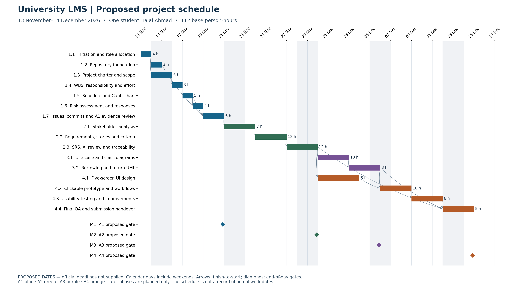

# University Library Management System

Software Engineering coursework · **Phase 1 / Assignment 1 only** · Reviewed 12 November 2026

## Project and problem

The case scenario describes a university library using manual records or an outdated system for membership, book borrowing, returns and overdue items. The proposed Library Management System (LMS) will support books, members, borrowing, returns, reservations and overdue notifications. This coursework specifies and designs that system; the assignment does not require a complete implementation.

## Objectives and scope

- Define the project, work packages, responsibilities, effort, dependencies and risks.
- Maintain a transparent GitHub repository with the required folders, meaningful commits and assigned task Issues.
- Plan later requirements/SRS, UML and clickable prototype deliverables as one consistent project.
- Address catalog/copy records, membership, search, issue/return, reservations and overdue notifications at the analysis and design level.

Production software, payment processing, live notifications, deployment, university SSO and real member-data migration are excluded. Borrowing limits, loan periods, fine policies and reservation precedence need stakeholder confirmation. University, department and official deadlines have not been supplied. Only fictional examples may be used.

## Stakeholders

Students and faculty borrow and reserve books; librarians manage circulation and catalog records; the library administrator oversees membership, policies and operations. The instructor assesses the coursework. These are scenario roles, not evidence of interviews or participation.

## Team and accountability

| Planned role | Actual student / GitHub account | Planned responsibility |
|---|---|---|
| Lead | Talal Ahmad / `talalahmad-ai` | Coordination, repository, schedule, quality and evidence |
| Analyst | Talal Ahmad / `talalahmad-ai` | Scope, stakeholder analysis and SRS |
| Designer | Talal Ahmad / `talalahmad-ai` | UML, interface prototype and usability work |

The user confirmed Talal Ahmad and his GitHub username. This plan uses one student holding three functional roles; no other students have been named. The assignment permits 1–3 students. `Hamza-Khaalid` is the authenticated preparation account, not an additional student. Assignments and estimates describe planned responsibility, not evidence of work performed by Talal. See the [responsibility matrix](reports/responsibility-matrix.md).

## Repository and access

Intended repository: <https://github.com/talalahmad-ai/university-library-management-system.>

The repository name has a literal trailing period. After the user corrected the URL, authenticated access, Write permission and cloning succeeded. The initial remote contained one README and commit `d6eb076`; that history is retained. The owner is `talalahmad-ai`. No replacement repository was created. The supplied starter ZIP was inspected separately before integration. The existing name differs from the PDF's literal requested name by its final period; confirm with the instructor or have the owner rename it before submission if exact spelling is enforced.

## Structure and document links

```text
requirements/       Assignment 2 boundary and future deliverables
diagrams/           Assignment 3 boundary and future deliverables
ui-prototype/       Assignment 4 boundary and future deliverables
reports/            Assignment 1 plan, sources, schedule, WBS, RACI, risks and QA
reports/evidence/   Genuine screenshots, probe logs and evidence index
.github/issue-drafts/  Prepared task definitions; not live Issues
scripts/            Artifact generation, validation and safe issue handover
```

[Project charter](reports/project-charter.md) · [WBS](reports/wbs.md) · [Schedule](reports/project-schedule.md) · [RACI and effort](reports/responsibility-matrix.md) · [Risks](reports/risk-register.md) · [Planning PDF](reports/assignment-1-plan.pdf) · [Editable workbook](reports/assignment-1-planning.xlsx) · [Compliance matrix](reports/compliance-matrix.md) · [Handover](START-HERE.md)

## Proposed phases and milestones

All dates are **planning assumptions**, not official submission deadlines. Calendar-day durations include weekends; availability must be confirmed.

| Gate | Proposed date | Deliverable |
|---|---|---|
| M1 / A1 | 20 November 2026 | Planning and verified GitHub evidence |
| M2 / A2 | 29 November 2026 | Reviewed requirements and SRS |
| M3 / A3 | 5 December 2026 | Four consistent UML diagrams |
| M4 / A4 | 14 December 2026 | Clickable prototype, real usability feedback and final submission |



## Tools and workflow

Git/GitHub support version history and task tracking. Markdown/CSV and an XLSX workbook are editable planning sources; Python, XlsxWriter, Matplotlib and ReportLab produce the workbook, charts and report. Playwright/Chromium capture actual browser renderings. diagrams.net and Figma are **planned later-phase tools**, not completed artifacts.

Review scope and estimates, confirm deadlines, track assigned Issues without duplication, and use incremental commits. The existing repository was cloned and inspected before changes. No rulesets or branch protection were reported at inspection; preserve the initial commit and use normal non-forced pushes.

## Current status and limitations

Assignment 1 documents and evidence are under preparation. Official deadlines and the repository-name discrepancy require confirmation. Consult the [evidence index](reports/evidence/README.md) and [compliance matrix](reports/compliance-matrix.md) for the final verified state of commits, assigned Issues and screenshots. Preparation commits are attributed to Codex and do not assert student participation. Assignments 2–4 are planned only and have not been executed.

## Source and attribution

The instructor's *Assignements 1 to 4 and Case scenario.pdf*, Assignment 1, is the assessment source. The uploaded README, starter ZIP and pasted master instruction are supporting material; they do not authorize executing later phases. See the [source review](reports/source-review.md). This package was prepared with Codex assistance; no interviews, student contributions or human test results are claimed.
