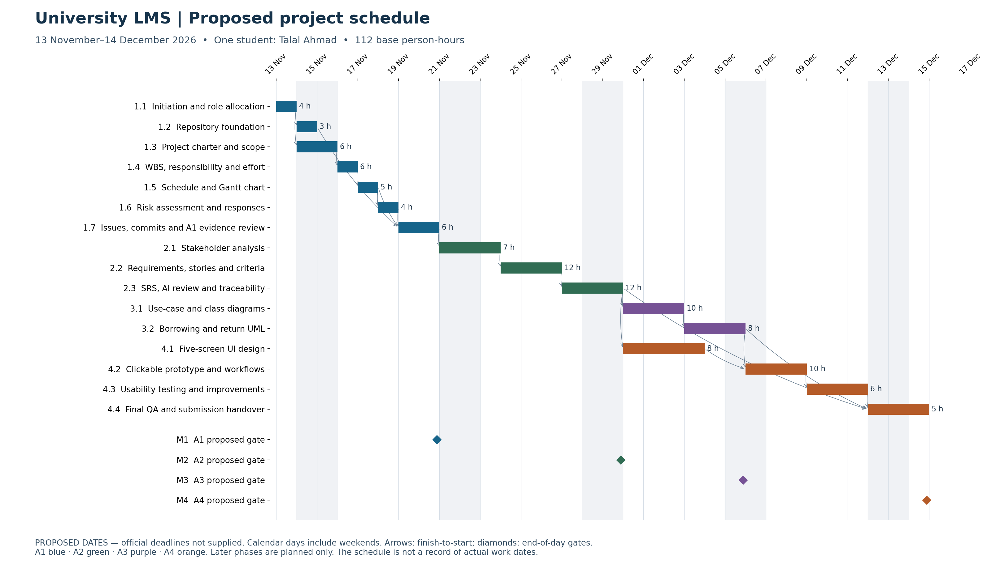

# Project schedule and Gantt

**All dates are proposed, not official deadlines.** Prepared 12 November 2026. This is a forward plan, not a record of work actually performed on those dates. The Phase 1 preparation occurred earlier than its proposed coursework gate.

| WBS ID | Phase | Activity | Start | End | Calendar days | FS predecessors | Hours |
| --- | --- | --- | --- | --- | --- | --- | --- |
| 1.1 | A1 | Initiation and role allocation | 2026-11-13 | 2026-11-13 | 1 | — | 4 |
| 1.2 | A1 | Repository foundation | 2026-11-14 | 2026-11-14 | 1 | 1.1 | 3.0 |
| 1.3 | A1 | Project charter and scope | 2026-11-14 | 2026-11-15 | 2 | 1.1 | 6 |
| 1.4 | A1 | WBS, responsibility and effort | 2026-11-16 | 2026-11-16 | 1 | 1.3 | 6 |
| 1.5 | A1 | Schedule and Gantt chart | 2026-11-17 | 2026-11-17 | 1 | 1.4 | 5 |
| 1.6 | A1 | Risk assessment and responses | 2026-11-18 | 2026-11-18 | 1 | 1.5 | 4 |
| 1.7 | A1 | Issues, commits and A1 evidence review | 2026-11-19 | 2026-11-20 | 2 | 1.2, 1.5, 1.6 | 6 |
| 2.1 | A2 | Stakeholder analysis | 2026-11-21 | 2026-11-23 | 3 | 1.7 | 7 |
| 2.2 | A2 | Requirements, stories and criteria | 2026-11-24 | 2026-11-26 | 3 | 2.1 | 12 |
| 2.3 | A2 | SRS, AI review and traceability | 2026-11-27 | 2026-11-29 | 3 | 2.2 | 12 |
| 3.1 | A3 | Use-case and class diagrams | 2026-11-30 | 2026-12-02 | 3 | 2.3 | 10 |
| 3.2 | A3 | Borrowing and return UML | 2026-12-03 | 2026-12-05 | 3 | 3.1 | 8 |
| 4.1 | A4 | Five-screen UI design | 2026-11-30 | 2026-12-03 | 4 | 2.3 | 8 |
| 4.2 | A4 | Clickable prototype and workflows | 2026-12-06 | 2026-12-08 | 3 | 3.2, 4.1 | 10 |
| 4.3 | A4 | Usability testing and improvements | 2026-12-09 | 2026-12-11 | 3 | 4.2 | 6 |
| 4.4 | A4 | Final QA and submission handover | 2026-12-12 | 2026-12-14 | 3 | 2.3, 3.2, 4.3 | 5 |

Every task is assigned to **Talal Ahmad (@talalahmad-ai)**. Functional roles are shown in the [CSV](project-schedule.csv), [RACI/effort table](responsibility-matrix.md) and [editable workbook](assignment-1-planning.xlsx).

## Milestones and submission deadlines

| Gate | Phase | Proposed readiness / submission target | Depends on | Official deadline |
| --- | --- | --- | --- | --- |
| M1 | A1 | 2026-11-20 | 1.7 | Not supplied |
| M2 | A2 | 2026-11-29 | 2.3 | Not supplied |
| M3 | A3 | 2026-12-05 | 3.2 | Not supplied |
| M4 | A4 | 2026-12-14 | 4.4 | Not supplied |

## Scheduling rules and feasibility

- Durations use inclusive calendar days, including weekends. A milestone is a zero-effort end-of-day gate.
- Every dependency is finish-to-start: the successor starts strictly after the predecessor's end date. The dependency graph must be acyclic.
- Concurrent tasks 3.1 and 4.1 use the same student. Daily load adds the effort/duration of all active packages across all roles; the maximum base load is six hours/day.
- Working-day availability is unconfirmed. A six-hour daily capacity is an estimate; replan if Talal has less time or does not work weekends.
- Total base effort is 112 hours. The unallocated 15% reserve is 16.8 hours; it is not hidden in task estimates and does not establish calendar float.
- The calculated critical dependency chain is 1.1 → 1.3 → 1.4 → 1.5 → 1.6 → 1.7 → 2.1 → 2.2 → 2.3 → 3.1 → 3.2 → 4.2 → 4.3 → 4.4 (32 calendar days). Task 1.2 has four days of float; 4.1 has two.
- All later phases are planned only. No student execution, stakeholder consultation or usability participation is claimed by this schedule.

Edit [planning-data.json](planning-data.json), regenerate with the two build scripts and rerun validation. The workbook can be edited for review; reconcile accepted edits back into the JSON before regenerating.
